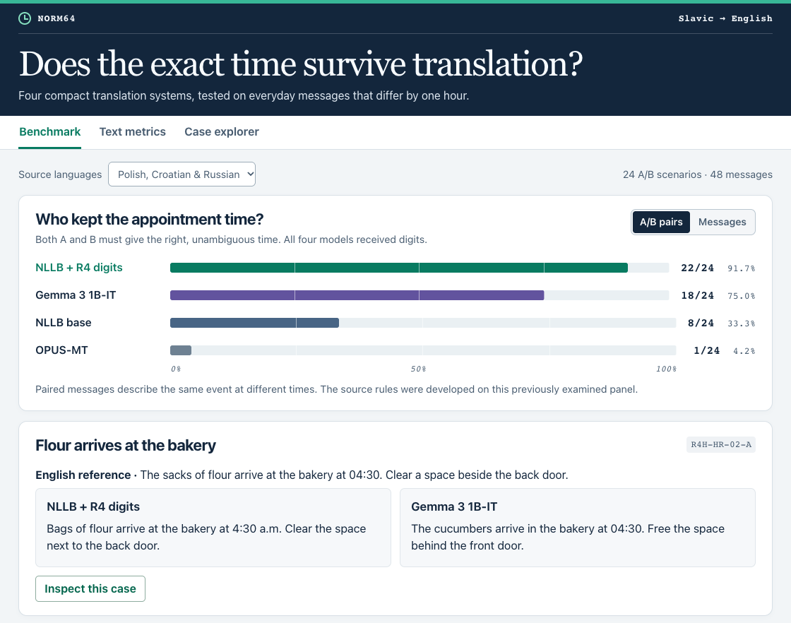

# Slavic-to-English translation with small language models

This project investigates compact models for offline translation from **Polish, Croatian and Russian into English**. We held **Ukrainian** out of fine-tuning to test transfer. Our focus is everyday messages where timing matters. If a bakery expects a delivery *u pola pet ujutro* in Croatian, its English-speaking staff need to know that means **4:30 a.m.**

After four rounds of LoRA fine-tuning on NLLB-200-distilled-600M (R1–R4), we tested a **neuro-symbolic approach**. Norm64 gives each scenario two messages with different start times. With colloquial wording, the final **R4 digits** adapter preserved both times in **none of the 24** Polish, Croatian and Russian scenarios. When a rule first converted each half-hour expression to 24-hour digits, the same adapter passed **22 of 24**. We compared four models on those inputs and used a separate numeric check to flag time discrepancies in their English translations.

[](docs/index.html)

**[Interactive dashboard](docs/index.html)** · On GitHub, choose **Download raw file** and open the saved HTML in your browser. In a local checkout, open `docs/index.html` directly. Choose a language, compare the four models or read both versions of a scenario. [Key research findings](#key-research-findings) · [Benchmark summary](#benchmark-summary) · [Repository structure](#repository-structure)

## Executive summary

A parent writing in Polish asked whether their daughter could answer a question after class. In one of our tests, the English translation asked the teacher to answer. For people who have moved abroad, a fluent sentence can change what happens next. Our goal is a translator that can run offline on a phone and help an English-speaking reader understand who should act, when, and under what conditions.

We used LoRA to fine-tune NLLB-200-distilled-600M and Gemma 3 1B-IT on 300,000 official translation pairs each. Polish, Croatian and Russian represent the West, South and East Slavic branches. All three use case endings to mark who did what to whom. We held Ukrainian out of fine-tuning to test whether learning from related languages helps when fewer translated examples are available.

Both models improved on official texts. On 72 everyday messages, Gemma’s average COMET score fell for Polish, Russian and Ukrainian. It rose for Croatian, though 18 messages leave the size and direction of that change uncertain. The next test asks independent readers what they would do after reading a translation and asks the writer whether that matches their intent. Phone performance also awaits testing. [Results by language](#what-changed-after-training)

One of the remaining clock errors moved filming nocturnal animals from **00:30** to **1:30 p.m.**, thirteen hours late. Gemma kept **00:30** on that Croatian message. The dashboard lets you read both outputs and decide what a camera operator would do. [Clock experiment and offline replay](#can-a-recipient-tell-the-exact-time)

## Historical precedent

In 1990, Brown and colleagues trained a statistical translation model on the Canadian Hansards, the English and French records of parliamentary debates. The model associated the English *Hear, hear!* with the French *Bravo!* because members used both expressions to signal approval in the chamber. [Brown et al., *A Statistical Approach to Machine Translation*](https://aclanthology.org/J90-2002/)

That precedent motivated our choice of EU and UN records, where the same proceedings and documents are available in several languages. Whether those translations help a parent write to a teacher or a worker agree on a shift is a separate question. We evaluate everyday messages for that reason.

The project began as a capstone for Google DeepMind’s AI Research Foundations course. [Course materials](https://github.com/google-deepmind/ai-foundations) · [Full research proposal](docs/research-proposal.md) · [PDF](docs/research-proposal.pdf)

## Run the notebooks

Open any notebook in Colab, select a CPU runtime and choose **Runtime → Run all**. The default examples use Python’s standard library and work without model downloads, credentials or a mounted Drive. Each notebook can also run on its own in Jupyter.

| Notebook | What you can check | Colab |
| --- | --- | --- |
| [Collect and clean parallel data](notebooks/01_collect_and_clean.ipynb) | Parse Europarl records, preserve meaningful symbols, group by document, and catch text overlap. An optional cell fetches and checks the original archives. | [Open in Colab](https://colab.research.google.com/github/Silveroboros-dev/slavic-english-slm/blob/main/notebooks/01_collect_and_clean.ipynb) |
| [Construct contrast questions](notebooks/02_build_contrast_questions.ipynb) | Change one word in a message, check that the answer flips, and present one version to a reader without showing the answer. | [Open in Colab](https://colab.research.google.com/github/Silveroboros-dev/slavic-english-slm/blob/main/notebooks/02_build_contrast_questions.ipynb) |
| [Compare LoRA experiments](notebooks/03_lora_experiments.ipynb) | Trace a low-rank update and target-token loss on small numerical examples. Compare the recorded results of the NLLB pilot, two matched Gemma runs and the full Gemma run. | [Open in Colab](https://colab.research.google.com/github/Silveroboros-dev/slavic-english-slm/blob/main/notebooks/03_lora_experiments.ipynb) |
| [Evaluate a translation decision](notebooks/evaluate_translation.ipynb) | Calculate observed COMET changes, then try a synthetic scheduling example where a small wording change alters the recipient’s answer. | [Open in Colab](https://colab.research.google.com/github/Silveroboros-dev/slavic-english-slm/blob/main/notebooks/evaluate_translation.ipynb) |

## What went into training

| Corpus | Direction | Pairs in the full Gemma run |
| --- | --- | ---: |
| [JRC-Acquis v3.0](https://joint-research-centre.ec.europa.eu/language-technology-resources/jrc-acquis_en) | Polish → English | 72,000 |
| [Europarl v10](https://www.statmt.org/europarl/v10/) | Polish → English | 28,000 |
| [DGT-TM, OPUS v2021](https://joint-research-centre.ec.europa.eu/language-technology-resources/dgt-translation-memory_en) | Croatian → English | 100,000 |
| [UN Parallel Corpus v1.0](https://www.un.org/dgacm/en/content/uncorpus) | Russian → English | 100,000 |

The NLLB pilot used document-level splits with 100,000 training pairs, 1,000 validation pairs and 1,000 test pairs per training language. The full Gemma run used the same training quotas after replacing 575 corrupted Croatian records and one malformed Russian table. The acquisition notebook lists the archive URLs and SHA-256 checksums. The [original pilot builder and verifier](pipeline/) read archives obtained from their publishers.

We also designed [36 synthetic everyday scenarios](data/b01_contrasts.jsonl). Each contains a Polish, Croatian or Russian message in two variants, English reference translations, one question and opposite expected answers. The 72 variants were reviewed for their intended reading. In the matched Gemma experiment, they replaced 72 of 384 official pairs in one arm. Both arms ran for 48 updates. A separate set of 72 historical messages was used for evaluation. The 300,000-pair Gemma run used official documents only.

## What changed after training

Gemma completed one epoch on a single NVIDIA L4 in 2 h 11 min 29 s of training time. Rank-8 LoRA updated 745,472 parameters. The [run record](results/gemma_run.json) includes the batching benchmark, precision, optimizer settings, timings and dataset hash.

| Source language | Everyday COMET, base → 300k (18 messages each) | Held-out COMET, base → 300k (32 pairs each) |
| --- | ---: | ---: |
| Polish | 0.6743 → 0.6373 | 0.7746 → 0.8383 |
| Croatian | 0.7483 → 0.7699 | 0.7792 → 0.8653 |
| Russian | 0.7723 → 0.7452 | 0.8304 → 0.8548 |
| Ukrainian | 0.7886 → 0.7569 | 0.8280 → 0.8257 |

The last column uses official documents for the three training languages. All three improved, with the largest gains on the Croatian official test across all three metrics (+17.86 BLEU, +13.24 chrF++ and +0.0861 COMET). For Ukrainian, we scored 32 general-domain sentences from the FLORES-200 benchmark. BLEU on those same sentences rose from 27.30 at baseline to 28.22 after 50,000 training pairs, then finished at 26.80 after 300,000. Final chrF++ (54.31 → 51.60) and COMET (0.8280 → 0.8257) also fell below baseline. [FLORES-200 dataset](https://huggingface.co/datasets/facebook/flores) · [Scores at each checkpoint](results/metrics.csv)

Everyday COMET rose only for Croatian, and its paired 95% interval for the change included zero. The [intervals](results/everyday_comet_intervals.csv) use 2,000 paired resamples of 18 messages per language from one training run. The separate 16-case stress set uses questions about the action a reader would take. It has no reference-based scores. Performance on new situations from participants and on phones remains to be measured.

The [full Gemma results](results/metrics.csv) give scores for the base model and the 10k, 50k and 300k checkpoints. For earlier experiments, see the [matched Gemma arms](results/gemma_matched_everyday.csv) and the [NLLB pilot](results/nllb_everyday.csv). These are aggregates over saved translations. The notebooks distinguish measurements from constructed examples.

## Key research findings

- **Training domain mattered.** After fine-tuning Gemma on official documents, Croatian official-test COMET rose from 0.7792 to 0.8653. On everyday Croatian, the smaller gain was within the uncertainty of an 18-message sample. [Everyday and held-out results](#what-changed-after-training)
- **A metric can miss a decision that matters to the reader.** Across 48 Polish, Croatian and Russian messages, writing source times in digits lifted R4 from zero to 22 complete clock scenarios while mean COMET moved from 0.7911 to 0.7897. [Raw and notation-adjusted scores](results/norm64_text_metrics.csv)
- **A numeric match can still change a commitment.** The checker flagged both wrong times in R4's normalized outputs. It also accepted Gemma's “around 9:30 PM” for a subtitle test scheduled at exactly 21:30. [Checker audit and examples](docs/norm64.md#what-the-numeric-check-caught)

## Can a recipient tell the exact time?

Each of 32 authored scenarios has two messages about the same event with different start times. A scenario passes when both English translations preserve their respective times unambiguously. We asked two questions.

1. **What does writing the time in digits add?** With colloquial half-hour expressions in the written messages, both base NLLB and NLLB with the R4 digits adapter passed **0/24** Polish, Croatian and Russian scenarios. After converting the time and its daypart to 24-hour digits, base NLLB passed **8/24** and R4 passed **22/24**. On the separate Ukrainian set, the corresponding changes were **0/8 to 4/8** and **0/8 to 8/8**. We kept each model's weights fixed between the two input formats.
2. **What does the model add once the time is explicit?** All four systems received the same 64 normalized messages and used greedy decoding. The table counts scenarios in which an English reader could recover the exact time from both A and B, using frozen, blinded agent readings.

### Benchmark summary

Each entry counts complete A/B scenarios after source normalization. Each language contributes eight scenarios.

| Source language | NLLB base | NLLB + R4 digits | OPUS-MT | Gemma 3 1B-IT |
| --- | ---: | ---: | ---: | ---: |
| Polish | 2/8 | 7/8 | 0/8 | 5/8 |
| Croatian | 3/8 | 7/8 | 1/8 | 6/8 |
| Russian | 3/8 | 8/8 | 0/8 | 7/8 |
| **Three training languages** | **8/24** | **22/24** | **1/24** | **18/24** |
| Ukrainian, separate | 4/8 | 8/8 | 0/8 | 7/8 |

Ukrainian contributed zero fine-tuning pairs. We supplied a Ukrainian normalization rule for this test. All four rules were developed for the constructions on this previously examined panel. On one Polish pair, R4 preserved both times but translated the milk tanker's unloading hose as a “snake”.

From the repository root, replay the counts and the numeric checker with Python’s standard library.

```sh
python3 pipeline/score_norm64.py
python3 -m unittest discover -s tests -v
```

[Method and observed failures](docs/norm64.md) · [64 cases, English translations and blinded readings](results/norm64_cases.jsonl) · [Model and run identities](results/norm64_run.json)

## Rebuild the original pilot

From the repository root, place the four verified archives in `slm-corpus-cache/` using the filenames in notebook 01. To acquire them with the notebook, set `download_archives` to `("europarl", "jrc", "dgt", "unpc")` in its optional cell. The four downloads total 2.85 GB. The builder also retrieves the DGT document index if it is absent. Use a fresh output directory.

```sh
python3 pipeline/build_pilot.py --data-dir slm-corpus-cache --cache-dir slm-corpus-cache --output-dir pilot-v1
python3 pipeline/verify_pilot.py pilot-v1
```

This rebuilds the NLLB pilot v1. The [NLLB training guide and original GPU trainer](training/) explain how to verify the frozen split and run the LoRA experiment. Gemma’s corrected v2 training file is identified separately in the run record. The upstream corpora and base models are distributed by their respective providers under their own terms. [NLLB model card](https://huggingface.co/facebook/nllb-200-distilled-600M) · [Gemma 3 model card](https://huggingface.co/google/gemma-3-1b-it)

## Repository structure

| To inspect or reproduce | Start here |
| --- | --- |
| Project proposal and clock experiment | [Research proposal](docs/research-proposal.md) · [Norm64 methods and limitations](docs/norm64.md) |
| Data preparation and reviewed A/B examples | [Pilot builder](pipeline/build_pilot.py) · [Split verifier](pipeline/verify_pilot.py) · [B01 contrasts](data/b01_contrasts.jsonl) |
| Colab notebooks and LoRA training | [Four notebooks](#run-the-notebooks) · [NLLB training guide](training/README.md) |
| Recorded translations and metrics | [Norm64 cases](results/norm64_cases.jsonl) · [Run settings](results/norm64_run.json) · [Corpus metrics](results/norm64_text_metrics.csv) |
| Clock rules, replay and dashboard | [Normalizer](pipeline/clock_normalize.py) · [Numeric checker](pipeline/clock_check.py) · [Scorer](pipeline/score_norm64.py) · [Dashboard builder](pipeline/build_norm64_dashboard.py) |
