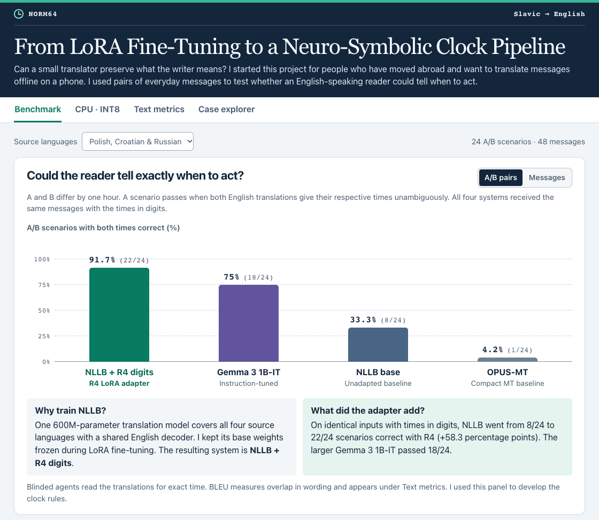

# Slavic-to-English translation with small language models

[](https://github.com/Silveroboros-dev/slavic-english-slm/actions/workflows/ci.yml?query=branch%3Amain)

<a id="executive-summary"></a>

In a Polish test message, a parent asked whether her daughter could answer a question after class. The English translation asked the teacher to answer. I started this project for people who have moved abroad and need to write messages like this in English. Can a compact translator preserve who should act, when and under what conditions? The goal is offline use on a phone. The training runs took place in Colab.

I chose **NLLB-200-distilled-600M** because one small translation model covers **Polish, Croatian, Russian and Ukrainian**. The first three represent the West, South and East Slavic branches and share features such as case endings that help identify who did what. I held Ukrainian out of fine-tuning to test transfer. After training on official documents, I used paired everyday messages to test whether a small wording change survived translation. In one Croatian case, a bakery expects flour *u pola pet ujutro*. Staff need to be ready at **4:30 a.m.**

After four rounds of LoRA experiments, I tested the final **NLLB + R4 digits** adapter on 24 clock scenarios in the three training languages. A scenario passed only when blinded agents could recover the exact time in **both** English translations. R4 passed **0/24** with colloquial times. With the same weights and a rule that rewrote each source time in 24-hour digits, it passed **22/24**. On the same normalized inputs, unadapted NLLB passed **8/24**, the larger Gemma 3 1B-IT **18/24**, and OPUS-MT **1/24**. The rules were developed on this panel. [Method and examples](docs/norm64.md)

[](https://silveroboros-dev.github.io/slavic-english-slm/)

**[Interactive dashboard](https://silveroboros-dev.github.io/slavic-english-slm/)** · Choose a language, compare the four models, or open the [INT8 comparison on a Colab CPU](https://silveroboros-dev.github.io/slavic-english-slm/#cpu-int8). For offline use, download the [standalone HTML file](https://github.com/Silveroboros-dev/slavic-english-slm/raw/refs/heads/main/docs/index.html) and open it in a browser. [Key research findings](#key-research-findings) · [Benchmark summary](#benchmark-summary) · [Compute, tokens and workflow](#compute-tokens-and-workflow) · [Repository structure](#repository-structure)

## Key research findings

- **An average score can hide a change in meaning.** Across the 48 Polish, Croatian and Russian clock messages, mean COMET moved from 0.79107 to 0.78974 as R4 went from 0/24 to 22/24 complete pairs. Both outputs were scored against the same original source and English reference. [Metric results](results/norm64_text_metrics.csv)
- **The checker caught a thirteen-hour error.** R4 moved filming nocturnal animals from 00:30 to 1:30 p.m. Gemma gave the correct 00:30. Across all 64 normalized R4 outputs, a separate numeric check flagged both wrong times and accepted all 62 correct ones. It also accepted Gemma’s “around 9:30 PM” for a subtitle test scheduled at exactly 21:30. [Checker audit and translations](docs/norm64.md#what-the-numeric-check-caught)
- **Training gains depended on the domain.** After 300,000 official pairs, Gemma’s Croatian official-test COMET rose from 0.7792 to 0.8653. On 18 everyday Croatian messages, the confidence interval for the smaller gain included zero. Everyday COMET fell for Polish, Russian and Ukrainian. [Results by language](#what-changed-after-training)
- **On the same Colab CPU, R4 preserved more clock pairs with less memory.** With both models in INT8, NLLB + R4 digits passed 22/24 Polish, Croatian and Russian pairs and 8/8 Ukrainian pairs. Gemma 3 1B-IT passed 19/24 and 7/8. Median latency was 2.59 vs. 3.96 s per message, peak RAM was 1.47 vs. 2.55 GiB, and the packages occupied 665.7 vs. 1,047.9 MB. [CPU benchmark](https://silveroboros-dev.github.io/slavic-english-slm/#cpu-int8)

## Run the notebooks

### Training and benchmarks

Start with **08** to verify the CPU comparison or **06** to inspect the trained adapter. Open a notebook on GitHub to read its saved outputs. In Colab, **Runtime → Run all** replays archived evidence on CPU using the public repository. New training, translation and COMET scoring are opt-in. Each notebook names the hardware, model and data it needs.

| Notebook | What you can reproduce | Colab |
| --- | --- | --- |
| [05 · Gemma LoRA on 300,000 pairs](notebooks/05_gemma_300k_lora_gpu.ipynb) | Inspect the PyTorch/PEFT loop, target-token alignment, batching and measured checkpoint results. Repeating the full L4 run requires the verified clean-v2 inputs and authorized Gemma weights. | [Open in Colab](https://colab.research.google.com/github/Silveroboros-dev/slavic-english-slm/blob/main/notebooks/05_gemma_300k_lora_gpu.ipynb) |
| [06 · NLLB R4 training](notebooks/06_nllb_r4_lora_training.ipynb) | Read the two 450-update training histories and inspect the contrastive loss. Try the same trainer on public B01 examples on a GPU. Repeating the historical run requires its original inputs. | [Open in Colab](https://colab.research.google.com/github/Silveroboros-dev/slavic-english-slm/blob/main/notebooks/06_nllb_r4_lora_training.ipynb) |
| [07 · Four-model clock audit and COMET](notebooks/07_norm64_four_model_and_comet.ipynb) | Recalculate exact-time scores for all four systems and mean COMET for the two R4 input formats. Optional cells generate fresh base NLLB and OPUS translations or rescore the saved R4 translations with COMET. | [Open in Colab](https://colab.research.google.com/github/Silveroboros-dev/slavic-english-slm/blob/main/notebooks/07_norm64_four_model_and_comet.ipynb) |
| [08 · INT8 inference on a Colab CPU](notebooks/08_norm64_cpu_int8_benchmark.ipynb) | Recalculate accuracy, latency, peak process RAM and package size from the two archived runs. Fresh inference supports either system and requires the matching R4 adapter or authorized Gemma weights. | [Open in Colab](https://colab.research.google.com/github/Silveroboros-dev/slavic-english-slm/blob/main/notebooks/08_norm64_cpu_int8_benchmark.ipynb) |

### CPU walkthroughs

These four notebooks use small embedded examples to explain decisions in the pipeline. Their default cells run with the Python standard library.

| Notebook | What you can check | Colab |
| --- | --- | --- |
| [01 · Collect and clean parallel data](notebooks/01_collect_and_clean.ipynb) | Parse Europarl records, preserve meaningful symbols, group by document, and catch text overlap. An optional cell fetches and checks the original archives. | [Open in Colab](https://colab.research.google.com/github/Silveroboros-dev/slavic-english-slm/blob/main/notebooks/01_collect_and_clean.ipynb) |
| [02 · Construct contrast questions](notebooks/02_build_contrast_questions.ipynb) | Change one word in a message, check that the answer flips, and present one version to a reader without showing the answer. | [Open in Colab](https://colab.research.google.com/github/Silveroboros-dev/slavic-english-slm/blob/main/notebooks/02_build_contrast_questions.ipynb) |
| [03 · LoRA walkthrough and experiment ledger](notebooks/03_lora_experiments.ipynb) | Trace a low-rank update and target-token loss on small numerical examples. Follow the saved results from the pilot through R2, R3, R4 and Norm64. | [Open in Colab](https://colab.research.google.com/github/Silveroboros-dev/slavic-english-slm/blob/main/notebooks/03_lora_experiments.ipynb) |
| [04 · Evaluate a translation decision](notebooks/evaluate_translation.ipynb) | Calculate observed COMET changes, then try a synthetic scheduling example where a small wording change alters the recipient’s answer. | [Open in Colab](https://colab.research.google.com/github/Silveroboros-dev/slavic-english-slm/blob/main/notebooks/evaluate_translation.ipynb) |

## What went into training

| Corpus | Direction | Pairs in the full Gemma run |
| --- | --- | ---: |
| [JRC-Acquis v3.0](https://joint-research-centre.ec.europa.eu/language-technology-resources/jrc-acquis_en) | Polish → English | 72,000 |
| [Europarl v10](https://www.statmt.org/europarl/v10/) | Polish → English | 28,000 |
| [DGT-TM, OPUS v2021](https://joint-research-centre.ec.europa.eu/language-technology-resources/dgt-translation-memory_en) | Croatian → English | 100,000 |
| [UN Parallel Corpus v1.0](https://www.un.org/dgacm/en/content/uncorpus) | Russian → English | 100,000 |

The NLLB pilot used document-level splits with 100,000 training pairs, 1,000 validation pairs and 1,000 test pairs per training language. The full Gemma run used the same training quotas after replacing 575 corrupted Croatian records and one malformed Russian table. The acquisition notebook lists the archive URLs and SHA-256 checksums. The [original pilot builder and verifier](pipeline/) read archives obtained from their publishers.

The study also includes [36 synthetic everyday scenarios](data/b01_contrasts.jsonl). Each contains a Polish, Croatian or Russian message in two variants, English reference translations, one question and opposite expected answers. The 72 variants were reviewed for their intended reading. In the matched Gemma experiment, they replaced 72 of 384 official pairs in one arm. Both arms ran for 48 updates. A separate set of 72 historical messages was used for evaluation. The 300,000-pair Gemma run used official documents only.

## What changed after training

Gemma completed one epoch on a single NVIDIA L4 in 2 h 11 min 29 s of training time. Rank-8 LoRA updated 745,472 parameters. The [run record](results/gemma_run.json) includes the batching benchmark, precision, optimizer settings, timings and dataset hash.

| Source language | Everyday COMET, base → 300k (18 messages each) | Held-out COMET, base → 300k (32 pairs each) |
| --- | ---: | ---: |
| Polish | 0.6743 → 0.6373 | 0.7746 → 0.8383 |
| Croatian | 0.7483 → 0.7699 | 0.7792 → 0.8653 |
| Russian | 0.7723 → 0.7452 | 0.8304 → 0.8548 |
| Ukrainian | 0.7886 → 0.7569 | 0.8280 → 0.8257 |

The last column uses official documents for the three training languages. All three improved, with the largest gains on the Croatian official test across all three metrics (+17.86 BLEU, +13.24 chrF++ and +0.0861 COMET). The Ukrainian test used 32 general-domain sentences from the FLORES-200 benchmark. BLEU on those same sentences rose from 27.30 at baseline to 28.22 after 50,000 training pairs, then finished at 26.80 after 300,000. Final chrF++ (54.31 → 51.60) and COMET (0.8280 → 0.8257) also fell below baseline. [FLORES-200 dataset](https://huggingface.co/datasets/facebook/flores) · [Scores at each checkpoint](results/metrics.csv)

Everyday COMET rose only for Croatian, and its paired 95% interval for the change included zero. The [intervals](results/everyday_comet_intervals.csv) use 2,000 paired resamples of 18 messages per language from one training run. The separate 16-case stress set uses questions about the action a reader would take. It has no reference-based scores. The next test is to ask independent readers what they would do in new situations and compare their answers with the writers’ intentions. Phone performance also awaits measurement.

The [full Gemma results](results/metrics.csv) give scores for the base model and the 10k, 50k and 300k checkpoints. For earlier experiments, see the [matched Gemma arms](results/gemma_matched_everyday.csv) and the [NLLB pilot](results/nllb_everyday.csv). These are aggregates over saved translations. The notebooks distinguish measurements from constructed examples.

## Can a recipient tell the exact time?

Each of 32 authored scenarios has two messages about the same event with different start times. A scenario passes when both English translations preserve their respective times unambiguously. I used these pairs to answer two questions.

1. **What does writing the time in digits add?** With colloquial half-hour expressions in the written messages, both base NLLB and NLLB with the R4 digits adapter passed **0/24** Polish, Croatian and Russian scenarios. After converting the time and its daypart to 24-hour digits, base NLLB passed **8/24** and R4 passed **22/24**. On the separate Ukrainian set, the corresponding changes were **0/8 to 4/8** and **0/8 to 8/8**. Each model used the same weights for both input formats.
2. **What does the model add once the time is explicit?** All four systems received the same 64 normalized messages and used greedy decoding. The table counts scenarios in which an English reader could recover the exact time from both A and B, using frozen, blinded agent readings.

### Benchmark summary

Each entry counts complete A/B scenarios after source normalization. Each language contributes eight scenarios.

| Source language | NLLB base | NLLB + R4 digits | OPUS-MT | Gemma 3 1B-IT |
| --- | ---: | ---: | ---: | ---: |
| Polish | 2/8 | 7/8 | 0/8 | 5/8 |
| Croatian | 3/8 | 7/8 | 1/8 | 6/8 |
| Russian | 3/8 | 8/8 | 0/8 | 7/8 |
| **Three training languages** | **8/24** | **22/24** | **1/24** | **18/24** |
| Ukrainian, separate | 4/8 | 8/8 | 0/8 | 7/8 |

Ukrainian contributed zero fine-tuning pairs. The test used a Ukrainian normalization rule. All four rules were developed for the constructions on this previously examined panel. On one Polish pair, R4 preserved both times but translated the milk tanker's unloading hose as a “snake”.

From the repository root, replay the counts and the numeric checker with Python’s standard library.

```sh
python3 pipeline/score_norm64.py
python3 -m unittest discover -s tests -v
```

[Method and observed failures](docs/norm64.md) · [64 cases, English translations and blinded readings](results/norm64_cases.jsonl) · [Model and run identities](results/norm64_run.json)

### INT8 inference on a Colab CPU

On the same 64 normalized messages, both INT8 models ran on the same two logical CPUs on an Intel Xeon in Google Colab. A pair passed when both English translations preserved the exact clock time. The Ukrainian panel used an explicit normalization rule and zero Ukrainian fine-tuning pairs.

| INT8 model | Polish, Croatian & Russian | Ukrainian | Median per message | p95 per message | Peak RAM (GiB) | Package (MB) |
| --- | ---: | ---: | ---: | ---: | ---: | ---: |
| NLLB + R4 digits | 22/24 | 8/8 | 2.59 s | 3.32 s | 1.47 | 665.7 |
| Gemma 3 1B-IT | 19/24 | 7/8 | 3.96 s | 4.74 s | 2.55 | 1,047.9 |

**[Open the CPU · INT8 dashboard](https://silveroboros-dev.github.io/slavic-english-slm/#cpu-int8)**

R4 kept its overall pair score. It corrected the Polish sourdough instruction to **4:30 a.m.** but moved the Croatian flour delivery from **4:30 a.m. to 4:30 p.m.** Gemma gained one Polish pair over its earlier 18/24. The inference engine also changed between runs, so the comparison cannot isolate the effect of quantization.

Both models used CTranslate2 4.9.1 (`int8_float32`) with greedy decoding and batch size one. After warm-up, each request was timed once from tokenization through the English output. Peak RAM covers the full process. Package size includes weights and tokenizer in decimal MB. Phone performance still needs a device test. [View raw per-message timings and scoring data (JSON)](results/norm64_cpu_int8.json)

## Compute, tokens and workflow

I framed the research question, chose the comparisons and reviewed the failures. Coding agents helped implement the experiments, run checks and prepare the notebooks. Between 20 and 24 November 2026, the project used at least **24 working notebooks** for data preparation, training and evaluation. The count excludes six reader copies and a preliminary Gemma launcher. [Public notebook index](#run-the-notebooks)

| Resource | Recorded use | How it was counted |
| --- | --- | --- |
| Fine-tuning | 9 runs · 20,581 optimizer updates · 656,256 training pairs presented | Six NLLB runs and three Gemma runs. Each repeat of a training pair counts as another presentation. |
| Training tokens | 56.01M source and target tokens, or 56.42M including the extra contrastive passes | Unpadded tokens across all six NLLB runs and the full Gemma run. The two short Gemma pilots and evaluation decoding are outside this count. |
| Google Colab | About 6 h 52 min in GPU runtimes and 53 min in CPU runtimes through the original resource audit | Reconstructed from recorded execution intervals. The GPU figure includes about 5 h 25 min in training and associated operations. The first NLLB run was timed from checkpoints. The later INT8 comparison added 7 min 1 s of timed CPU inference. |
| Codex | 1,330.47M tokens, including 1,311.24M cached input tokens (98.55% of the total) | Up to the start of the 24 November resource audit, the main project chat and its coding agents used 16,496,499 uncached input tokens and generated 2,736,868 output tokens (19.23M combined). External reviewers are outside this count. |

For one directly timed run, **Gemma 3 1B-IT trained on 300,000 pairs in 2 h 11 min 29 s on a single NVIDIA L4**. That timer covered batch preparation, transfer and optimization, including the forward and backward passes. Project records do not establish idle rental time or billed Colab Compute Units. [Gemma training record](results/gemma_run.json)

## Rebuild the original pilot

From the repository root, place the four verified archives in `slm-corpus-cache/` using the filenames in notebook 01. To acquire them with the notebook, set `download_archives` to `("europarl", "jrc", "dgt", "unpc")` in its optional cell. The four downloads total 2.85 GB. The builder also retrieves the DGT document index if it is absent. Use a fresh output directory.

```sh
python3 pipeline/build_pilot.py --data-dir slm-corpus-cache --cache-dir slm-corpus-cache --output-dir pilot-v1
python3 pipeline/verify_pilot.py pilot-v1
```

This rebuilds the NLLB pilot v1. The [NLLB training guide and original GPU trainer](training/) explain how to verify the frozen split and run the LoRA experiment. Gemma’s corrected v2 training file is identified separately in the run record. The upstream corpora and base models are distributed by their respective providers under their own terms. [NLLB model card](https://huggingface.co/facebook/nllb-200-distilled-600M) · [Gemma 3 model card](https://huggingface.co/google/gemma-3-1b-it)

## Historical precedent

In 1990, Brown and colleagues trained a statistical translation model on the Canadian Hansards, the English and French records of parliamentary debates. The model associated the English *Hear, hear!* with the French *Bravo!* because members used both expressions to signal approval in the chamber. [Brown et al., *A Statistical Approach to Machine Translation*](https://aclanthology.org/J90-2002/)

That precedent motivated my choice of EU and UN records, where the same proceedings and documents are available in several languages. Whether those translations help a parent write to a teacher or a worker agree on a shift is a separate question. That is why the project also tests everyday messages.

The project began as a capstone for Google DeepMind’s AI Research Foundations course. [Course materials](https://github.com/google-deepmind/ai-foundations) · [Full research proposal](docs/research-proposal.md) · [PDF](docs/research-proposal.pdf)

## Repository structure

| To inspect or reproduce | Start here |
| --- | --- |
| Project proposal and clock experiment | [Research proposal](docs/research-proposal.md) · [Norm64 methods and limitations](docs/norm64.md) |
| Data preparation and reviewed A/B examples | [Pilot builder](pipeline/build_pilot.py) · [Split verifier](pipeline/verify_pilot.py) · [B01 contrasts](data/b01_contrasts.jsonl) |
| Notebooks and training | [Eight Colab notebooks](#run-the-notebooks) · [NLLB training guide](training/README.md) |
| R4 training | [LoRA trainer](training/train_r4.py) · [Loss histories for both 450-update runs](results/r4_training_archive.json) |
| INT8 on a Colab CPU | [Model conversion](training/prepare_norm64_int8.py) · [Benchmark runner](pipeline/bench_norm64_cpu.py) · [Timings and scores (JSON)](results/norm64_cpu_int8.json) |
| Recorded translations and metrics | [Norm64 cases](results/norm64_cases.jsonl) · [Run settings](results/norm64_run.json) · [Corpus metrics](results/norm64_text_metrics.csv) |
| Clock rules, replay and dashboard | [Normalizer](pipeline/clock_normalize.py) · [Numeric checker](pipeline/clock_check.py) · [Scorer](pipeline/score_norm64.py) · [Dashboard builder](pipeline/build_norm64_dashboard.py) |
